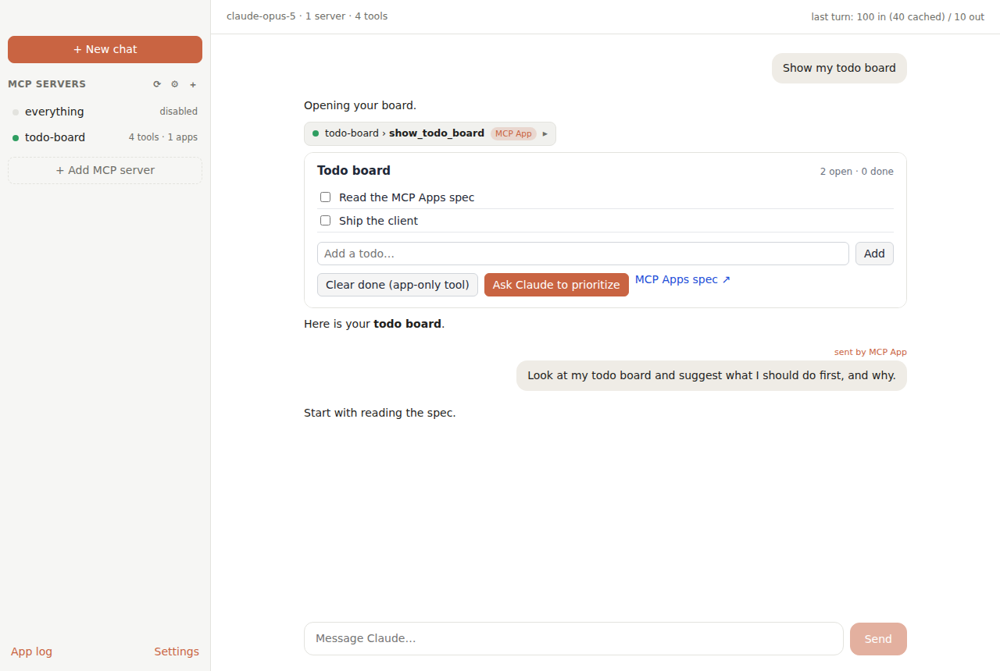

# Tidepool

A small, hackable desktop app that is a shared place where **humans, agents and websites or
services interact**. You chat, an agent works alongside you, and the sites and MCP servers you use
are right there too: pinned in the sidebar, rendered inline as **MCP Apps** (interactive UIs that
servers ship as `ui://` resources), and open to the agent through the tools they expose. It is a
client you control end to end, so you can explore what that three-way collaboration can look like.

Today the built-in agent is Claude (through your own Anthropic API key); the app, its tools and its
MCP and WebMCP plumbing are not specific to it.



## Features

- **Claude chat** with streaming, adaptive thinking (summaries shown inline), a model and effort
  picker, and a stop button. It defaults to `claude-opus-5` with server-side refusal fallbacks.
- **MCP servers** over stdio, Streamable HTTP or legacy SSE. Manage them from the UI, or paste a
  `claude_desktop_config.json`-style config.
- **MCP Apps host** built on the official
  [`@modelcontextprotocol/ext-apps`](https://github.com/modelcontextprotocol/ext-apps) `AppBridge`:
  - Tools with `_meta.ui.resourceUri` render their UI inline in the chat, and the app receives the
    tool input and result.
  - Apps can call server tools, read resources, open links, resize themselves, go fullscreen and
    send log messages. A fullscreen app always gets a host bar naming it and an **Exit fullscreen**
    button; `Esc` works too, including while the app itself has focus.
  - **The chat stays with you in fullscreen.** It docks on the right so you can ask about what the
    app is showing (a recipe step, a chart) without leaving it. **Hide chat** gives the app the
    whole window; the choice is remembered.
  - `ui/message` posts a user message into the chat, labelled "sent by MCP App".
  - `ui/update-model-context` is attached to your next message as `<app_context>`.
  - Tool visibility is enforced: `["app"]`-only tools are hidden from Claude, and apps can't call
    `["model"]`-only tools.
  - Host theme and CSS style variables are passed to the app, and theme changes are forwarded.
- **Pinned sites** alongside MCP servers: pin sites like Gmail or Google Chat to the sidebar,
  sign in once, and stay signed in. The chat docks beside them. See [Websites](#websites).
- **Saved chats, per project.** Every chat belongs to a project (a built-in **General** project
  catches the rest) and is saved as you go, MCP Apps included, so it reopens after a restart.
  The sidebar lists the open project's chats; Claude Haiku names each one after its first
  exchange. Several chats can answer at once. Chats live in `app.db` (SQLite) in the app's
  data folder.
- **Browsing history.** Every page opened in a project tab or pinned site is recorded with its
  title and when you visited. **History** (bottom left, or ⌘Y) searches it by title or address,
  for all projects or just the current one; remove single visits or clear it all there.
- **Claude can use the app.** Besides your MCP servers, Claude gets the app's own tools: list and
  open projects, list, open, read and close a project's tabs, search your browsing history and
  earlier chats, and search the web (Anthropic's server-side search, billed per search; turn it
  off in Settings). Tools act on the chat's project unless you ask about another.
  - **Opening a page after reading one asks you first.** Page text, site tool results and search
    results are what websites wrote, and an address can carry data away, so once a turn has read
    any of them, Claude's next `open_page` shows the address and waits for **Open** or **Deny**.
  - **Acting on a site after reading another asks you first, too**, even on a site you always
    allow, and without offering **Always allow**: an email mustn't be able to turn off the heating.
    Reading the site you're acting on doesn't count.
- **Memory per project.** Claude keeps notes with Anthropic's memory tool and reads them when a
  chat starts. Each project has its own; other projects can't see them. Read, fix or delete them
  from a project's ⋯ menu → **Memory…**, or turn memory off in Settings.
- **Projects** for everything else: named sets of browser tabs, listed in the sidebar under
  **Projects**, each with a horizontal tab strip and an address bar that goes to URLs or searches.
  Links from the chat, from MCP Apps and from pinned sites open as a tab in the project you used
  last (turn that off in Settings to use your default browser). See [Projects](#projects).
- **Hands-free voice input** (macOS). Tap the mic and talk; the message sends itself when you
  pause. Recognition runs on your Mac, so audio never leaves it. See [Voice input](#voice-input).
- **An App log** (bottom left) that shows bridge traffic, which helps when you're debugging an app.
- **WebMCP page tools.** Websites can register tools with
  [WebMCP](https://webmachinelearning.github.io/webmcp/) (`document.modelContext.registerTool()`,
  Chromium's native implementation), and Claude can call the open website's tools alongside your
  MCP servers' (Target's product search, for one). The list follows the page: when a tool
  navigates and the next page registers different tools, Claude sees those on its next step.
  **Page tools** (bottom left) shows what the open website has registered, with schemas.
  - **Suggestions.** When the open page offers tools, a row of suggestions sits above the
    composer ("Export the timeline as MP4", "Filter under $20"). They come from one small Claude
    Haiku call per page and tool set, cached per site, and change as the page's tools do.
    Picking one sends it as a message, so Claude still asks before running anything. Only
    suggestions for tools the page really has are shown, and they're labelled with the site
    they came from. Turn them off in Settings.
  - **You approve each call.** The chat shows the tool and exactly what it would send, with
    Allow, Deny and "Always allow on this site" (undo it in Page tools). Read-only tools ask
    too, since a site can claim anything. Stop cancels a waiting call.
  - **What sites write is marked as theirs.** Tool results and descriptions reach Claude inside
    `<website_content>` tags, and Claude is told to treat that as data, not instructions. Results
    are text only, and results a site flags with `untrustedContentHint` carry an extra warning.
    This lowers the risk of prompt injection from a site; it doesn't remove it, which is why
    calls need your OK. Tools from cross-origin iframes
  only appear if the page opts them in, per the spec.

## Getting started (macOS)

Requires **Node.js 22.12 or later** (Electron 44's installer needs it). With `nvm`, run `nvm use`
in the project directory to pick up the bundled `.nvmrc`.

```bash
npm install
npm run dev          # hot reload; main/preload changes rebuild and restart the app
```

On first launch, open **Settings** and paste your Anthropic API key. It's encrypted with the macOS
Keychain via Electron `safeStorage`. Alternatively, launch with `ANTHROPIC_API_KEY` set.

### Install it as an app

Download an installer for your platform from the
[Releases](https://github.com/pathofleastresistor/tidepool/releases) page: `.dmg` (macOS, Apple
silicon or Intel), `.exe` (Windows) or `.AppImage` / `.deb` (Linux). None of them are signed, so
macOS and Windows will warn on first launch (see below). Or build one yourself:

```bash
npm run dist:mac     # → dist/tidepool-0.1.0-mac-arm64.dmg (and -x64)
npm run dist:win     # → dist/tidepool-0.1.0-win-x64.exe (build on Windows)
npm run dist:linux   # → dist/tidepool-0.1.0-linux-x64.AppImage and .deb (build on Linux)
```

On Windows, SmartScreen shows "Windows protected your PC": choose **More info**, then **Run anyway**.
Voice input and the Chrome import are macOS-only.

Open the `.dmg` and drag **Tidepool** into Applications. The build is unsigned. If macOS refuses to
open it ("damaged" or "can't be opened"), clear the quarantine flag and ad-hoc sign it:

```bash
xattr -cr "/Applications/Tidepool.app"
codesign --force --deep --sign - "/Applications/Tidepool.app"
```

To sign properly, set `CSC_LINK`/`CSC_KEY_PASSWORD` and remove `identity: '-'` from
`electron-builder.yml`.

### Troubleshooting

**`Error: Electron uninstall` on `npm run dev`** — the Electron binary wasn't downloaded, which happens
when `npm install` ran on Node older than 22.12 (its installer fails silently) or with `--ignore-scripts`.
Switch to Node 22+ and fetch it:

```bash
nvm use                                  # or: nvm install 22
node node_modules/electron/install.js
```

**The app exits with `Cannot read properties of undefined (reading 'setName')`** — something in the
environment set `ELECTRON_RUN_AS_NODE=1`, so Electron booted as plain Node with no `app` module. Editor
extension hosts (VS Code's, for one) set this. Run from a normal terminal, or prefix the command with
`env -u ELECTRON_RUN_AS_NODE`.

## Adding MCP servers

Open **Settings → MCP servers**, click **+ Add server** and choose one of:

- **Remote (URL)**: the server's URL, the transport (Streamable HTTP or SSE), and optional headers
  such as `Authorization: Bearer …`.
- **Local (command)**: a command and its arguments (for example `npx` +
  `-y @modelcontextprotocol/server-everything`), plus optional environment variables and working
  directory.

The same page lists your servers: click one to see its tools, or edit, enable or disable, and remove
it. **Reconnect all** restarts every server, and **Edit JSON** lets you paste config straight from
Claude Desktop. A red dot on **Settings** means a server failed to connect. Everything
is saved to `~/Library/Application Support/MCP Client/mcp.json`:

```json
{
  "mcpServers": {
    "todo-board": { "command": "node", "args": ["/path/to/tidepool/examples/todo-app-server.mjs"] },
    "remote": { "url": "https://example.com/mcp", "headers": { "Authorization": "Bearer …" } },
    "legacy": { "url": "https://example.com/sse", "transport": "sse" },
    "off": { "command": "uvx", "args": ["some-server"], "disabled": true }
  }
}
```

Apps opened from Finder get a minimal `PATH`, so at startup the client reads your login shell's
`PATH`. That means `npx`, `uvx` and Homebrew binaries resolve the same way they do in Terminal.

## Try the example MCP App

`examples/todo-app-server.mjs` is a dependency-light stdio server (no build step) that exercises most
of the MCP Apps surface: tool input and result, app-initiated tool calls, an app-only tool,
`ui/message`, `ui/update-model-context`, `ui/open-link`, auto-resize and host theming.

1. Add it as a **Local** server with command `node` and arguments
   `/absolute/path/to/tidepool/examples/todo-app-server.mjs`.
2. Ask Claude: *"show my todo board"*.
3. Add or check off items in the board, or click **Ask Claude to prioritize**.

For more servers to try, see the
[ext-apps examples](https://github.com/modelcontextprotocol/ext-apps/tree/main/examples): maps,
PDFs, 3D, charts and more. Most of them run as `npx`-able servers or on a local URL.

## Websites

Pinned sites sit in the sidebar like vertical browser tabs. **Pin a site** takes an address
(`gmail.com` is fine), an optional name, and an optional note on what it's for. Click a tab to open the site in the main area, with
back, forward, reload and open-in-your-browser controls, and drag tabs to reorder them. The chat
docks on the right; **Hide chat** gives the site the whole width, and **Chat** at the top of the
sidebar goes back to the chat. Sites you've opened keep running in the background, so switching
between them is instant; a tab's ✕ closes the page (the site stays in the list, dimmed, until you
open it again).

- **Staying signed in.** All sites, pinned or in a project, share one browser profile, kept on disk between launches like
  a Chrome profile, so one Google sign-in covers Gmail and Chat. Settings has **Sign out of all
  websites**, which clears that profile's cookies and storage. The profile is separate from the
  app itself: sites can't reach the app, your files or your MCP servers.
- **Links and popups.** Links that open a new tab open in a project (see below), or your default
  browser if that's turned off. Sign-in links load in the site itself, so it's this profile that
  signs in. Popups a site opens itself (sign-in and sharing windows) stay in the app so they can
  finish.
- **Claude knows them, in every chat.** Each chat's system prompt lists your pinned sites with
  their name, address and an optional **What it's for** note you write when you pin or edit one
  ("Home Assistant: lights, fans and locks"). So "turn off the fan" goes to your Home Assistant
  instead of getting "I have no home automation integration". Only your own words are listed;
  nothing comes from the pages. Claude reaches a site the best way it has:
  1. its **connection**, an MCP server that reaches it. **Automatic** picks a server in `mcp.json`
     whose address is on the site's host (Home Assistant serves one at `/api/mcp`), or pick one or
     **None** when you edit the site;
  2. the site's own WebMCP tools, while it's loaded;
  3. `read_page` and `browse` with the site's `site_id`, working the page you're signed in to.
     Browsing puts the site on screen so you see it; `open_site` shows one too.

  Reading a pinned site doesn't ask. Acting on it does (browse, its WebMCP tools, and its
  connection's tools unless they're marked read-only) until you choose **Always allow**, which
  you can undo from the site's **Edit** dialog.
- **Permissions.** Sites may show notifications, go fullscreen and write to the clipboard.
  Camera, microphone and location are refused, so calls in Chat or Meet won't work here.
- Browser shortcuts work in the site you're on: ⌘R reloads, ⌘[ and ⌘] go back and forward, ⌘F
  finds, and ⌘= / ⌘- / ⌘0 zoom (kept per site, as in Chrome). See
  [Keyboard shortcuts](#keyboard-shortcuts).

## Projects

A project is a named set of tabs and chats. Each one is a single row in the sidebar; click it to
open the project. Its tabs run along the top of the page, like a browser's, and the first is the
project's **Home**, which can't be closed. Home lists every chat in the project, with **New chat**,
and has a box that opens a URL, a hostname or a search in a new tab. **New project** asks for a
name and opens on its Home, with the cursor in that box.

After Home come the project's tabs: **+** opens another, links a page opens in a new tab land
beside it, drag tabs to reorder them, and ✕ (or a middle-click) closes one. Right-click a tab to
move it to another project or Everyday, or drag it onto Everyday or a project row in the sidebar.
Closing the last tab goes back to Home. The toolbar has back, forward, reload, the address bar,
**Pin** (adds the page to Pinned) and open in your browser. Everyday's tabs stay in the sidebar,
listed down it.

Editing lives in the sidebar: hover a pinned site or project and click **⋯**, or right-click it.
Pinned sites have **Edit…** (address and name) and **Unpin**; projects have **Rename…** and
**Delete project**, which closes its tabs. Unpinning and deleting ask first.

- **Where links go.** Links from the chat, MCP Apps and pinned sites open as a new tab in the
  project you used last, and the app switches to it. If you have no projects, one called
  "Browsing" is made.
- **Kept between launches.** Projects and their tabs are saved in `projects.json` in the app's
  data folder. Restored tabs load only when you first look at them.
- **Page tools.** The active tab of the project on screen offers its WebMCP tools, like a pinned
  site. "Always allow" in a tab applies to that site's origin in any project tab; it's separate
  from the same site pinned.

## Keyboard shortcuts

Shortcuts follow browsers for tabs and pages, and chat apps for the assistant. Every one is in
the menu bar, **⌘/** lists them all, and **Settings › Keyboard** changes any of them (click one
and press the keys you want). On Windows and Linux, ⌘ is Ctrl.

| | |
| --- | --- |
| **Chat** | ⌘N new chat · ⌘J show or hide the chat · ⇧Esc focus the message box · ⌘⇧Space talk · ⌘. or Esc (in the message box) stop the reply · ⌘⇧; copy the last reply |
| **Tabs** | ⌘T new tab · ⌘W close tab (never the window; that's ⌘⇧W) · ⌘⇧T reopen closed tab · ⌃Tab / ⌃⇧Tab next and previous tab · ⌘L address bar |
| **Page** | ⌘R reload · ⌘⇧R hard reload · ⌘[ / ⌘] back and forward · ⌘F find (in the chat when you're in it) · ⌘G / ⌘⇧G next and previous match · ⌘= / ⌘- / ⌘0 zoom · ⌘D pin the page |
| **Go** | ⌘K Quick Open: jump to a site, project, tab or chat, or run any command · ⌘1–⌘8 sidebar items, ⌘9 the last · ⌘⇧H Home · ⌘Y history (Ctrl+H on Windows and Linux) |
| **App** | ⌘, Settings · ⌘⇧M project memory · ⌘/ all shortcuts |

Escape closes one thing at a time, the one on top: a menu, then a dialog, then the find bar or a
fullscreen app.

- **Websites keep their own keys.** Plain keys, and ⌘K, ⌘/, ⇧Esc and ⌘⇧; ("page first" in
  Settings), go to a site while you're typing in it, so Slack's and Linear's ⌘K still work. The
  rest are the app's wherever you are, as a browser's tab shortcuts are.
- **Talk from anywhere.** Settings › Keyboard can set a shortcut that works from any app: it
  brings Tidepool forward and starts listening. It's off until you set one.
- **How it works.** `src/shared/commands.ts` lists every command and its keys. The menu bar
  (`src/main/menu.ts`) is built from it, and is what catches keys while a website (a native view
  the app's page never hears from) has the keyboard. In the app and its overlays, keys are matched
  in the page (`src/renderer/src/commands.ts`). A key both see is only acted on once.

## Voice input

Tap the **mic** next to Send and talk. Your words appear in the chat box as they're recognized,
and the message sends itself when you pause for about a second and a half, which suits using an
app like a recipe with your hands full. Tap the mic (or press Send) to send before the pause, or
**Cancel** to discard. Anything you'd already typed stays in front of what you say. If Claude is
still answering, what you said is held and sent as soon as the answer finishes.

Recognition uses Apple's on-device speech recognition through a small Swift helper
(`native/speech-helper`), built automatically by `npm run dev` / `npm run build`. It needs the
Xcode command line tools (`xcode-select --install`); without them the mic button just doesn't
appear. Audio is never sent to Apple: if on-device recognition isn't available for your
language, voice input reports that instead of falling back to the network.

The first time, macOS asks for **Microphone** and **Speech Recognition** access for "Tidepool
Speech". The helper takes those permissions itself rather than inheriting them from whatever
launched the app, so the prompts name it however you start Tidepool. If you decline, the app
links to the right pane of System Settings. Rebuilding the helper (only when its source
changes) makes macOS ask again, because the local build is ad-hoc signed.

## How it works

```
┌──────────────── main process (Node) ────────────────┐
│ McpManager   – @modelcontextprotocol/client (v2),   │
│                stdio / Streamable HTTP / SSE        │
│ ChatSession  – Claude agent loop (streaming,        │
│                tool_use → MCP tools/call → results) │
│ mcp-sandbox:// protocol – serves the sandbox proxy  │
│                with a CSP built from the app's meta │
└──────────▲──────────────────────────────────────────┘
           │ IPC (preload contextBridge: window.api)
┌──────────┴──────── renderer (React) ────────────────┐
│ Transcript → AppFrame (AppBridge + PostMessage)     │
│   └─ <iframe src="mcp-sandbox://<server-key>/…">    │  sandbox proxy (own origin per server)
│        └─ <iframe> app HTML (document.write)        │  the MCP App itself
└─────────────────────────────────────────────────────┘
```

- **Security model.** App HTML is untrusted. It runs two iframes deep, following the spec's
  double-iframe design. The outer proxy is served from a custom `mcp-sandbox://` scheme with one
  origin per server, so apps can't reach the renderer, the preload bridge, or another server's
  storage. The CSP allows network access only to the domains the resource declares in
  `_meta.ui.csp`. Popups and navigations open in your default browser.
- **Conversation state** lives in the main process as Anthropic `MessageParam[]`. History is
  append-only, the tool list is sorted for a stable prompt-cache prefix, and parallel tool calls
  run concurrently.

| Path | What's there |
| --- | --- |
| `src/main/mcp-manager.ts` | Server connections, tool/resource listing, MCP Apps metadata and visibility |
| `src/main/chat.ts` | Claude streaming agent loop, MCP result → `tool_result` conversion |
| `src/main/projects.ts`, `src/renderer/src/components/Projects.tsx` | Projects: saved tab sets, their views, the tab strip and address bar |
| `src/main/sandbox.ts` | `mcp-sandbox://` scheme, proxy HTML, and CSP builder |
| `src/main/web-apps.ts`, `src/renderer/src/components/Web.tsx` | Pinned sites: the saved list, the persistent profile, and the views laid over the window |
| `src/main/speech.ts`, `native/speech-helper/` | Voice input: the on-device recognizer and its process manager |
| `src/renderer/src/components/AppFrame.tsx` | The MCP Apps host (AppBridge wiring) |
| `src/renderer/src/components/ServersPanel.tsx` | Add, edit and remove servers (in Settings) |

## Scripts

| Command | |
| --- | --- |
| `npm run dev` | Electron with hot reload (renderer) and auto-restart (main, preload) |
| `npm run typecheck` | TypeScript for main, preload and renderer |
| `npm run build` | Production bundle into `out/` |
| `npm run dist:mac` / `dist:win` / `dist:linux` | Build installers for that OS into `dist/` (build on the matching OS) |

To cut a release, bump `version` in `package.json`, then push a matching tag (`git tag v0.1.1 && git push origin v0.1.1`). The Release workflow builds all three platforms and attaches the installers to a GitHub release.

| `node tests/e2e-webmcp.mjs` | End-to-end test for WebMCP page tools against a local fake shop and a mock Claude API (after `npm run build`) |
| `npm run test:e2e` | End-to-end smoke test against a mock Claude API and the example server (no API key needed) |
| `node tests/e2e-assistant.mjs` | End-to-end test for Claude's app tools, the check before opening pages, history, chat search and memory (after `npm run build`) |
| `node tests/e2e-shortcuts.mjs` | End-to-end test for keyboard shortcuts, the menu bar, Quick Open, find in page, zoom and changing shortcuts (after `npm run build`) |
| `npm run test:e2e:all` | Builds, then runs all four end-to-end tests |

## Known gaps

- OAuth for remote servers isn't implemented yet. Use servers that accept header tokens, or none.
- There's a single conversation, kept in memory only (**New chat** clears it).
- MCP prompts, sampling and elicitation aren't surfaced.
- Google refuses to sign in inside embedded browsers ("This browser or app may not be secure"), so a
  banner above the page offers to open the site in your default browser instead.
- Projects have no downloads UI yet. Tabs can't be dragged between projects or onto Pinned; use
  **Pin** (⌘D) instead.
